# GTA: Three Legends

Mini open world 3D per **Android** realizzato con **Godot 4.4 (GDScript)**, ispirato alle meccaniche classiche dei GTA ma semplice, leggero e pensato per lo smartphone.

Tre protagonisti realmente giocabili, una storia originale che comincia in volo, 8 missioni, auto guidabili, traffico, pedoni, **armi**, **polizia con livello di ricercato fino a 5 stelle**, **multiplayer in rete locale** (fino a 4 giocatori), salute con i *Brown Boost*, salvataggi locali e comandi touch.

> **Download:** l'APK firmato viene pubblicato automaticamente nelle [GitHub Release](../../releases/latest) dalla pipeline di GitHub Actions.

| | |
|---|---|
| 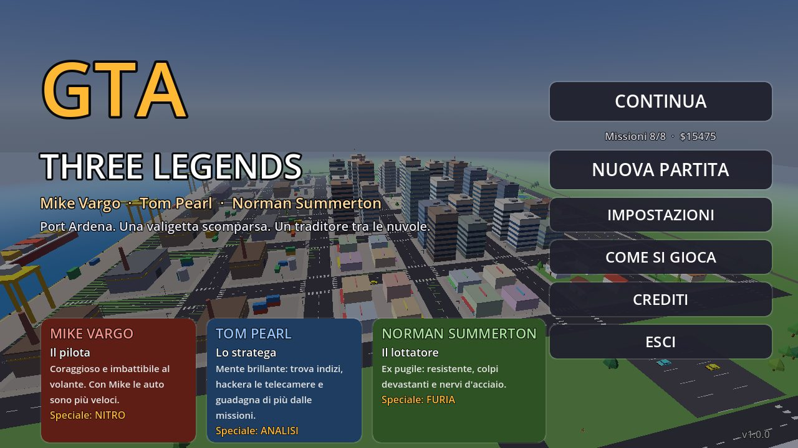 | 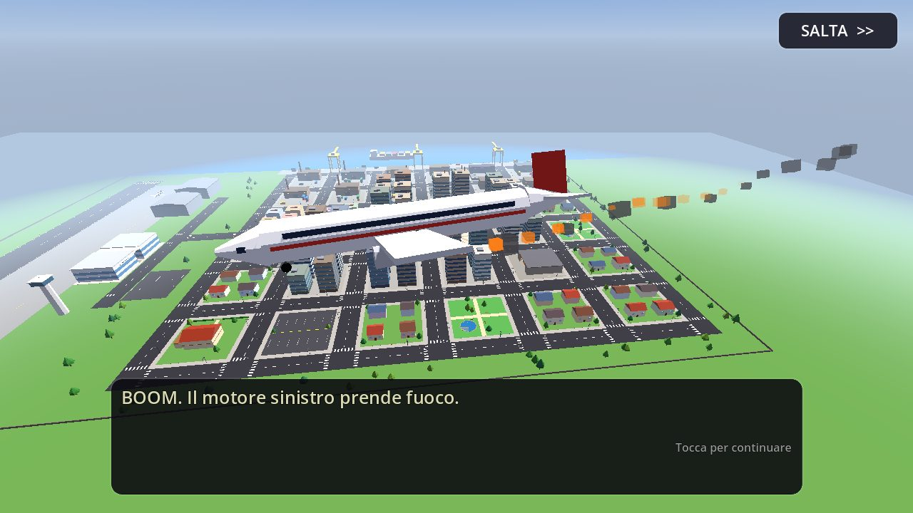 |
|  | 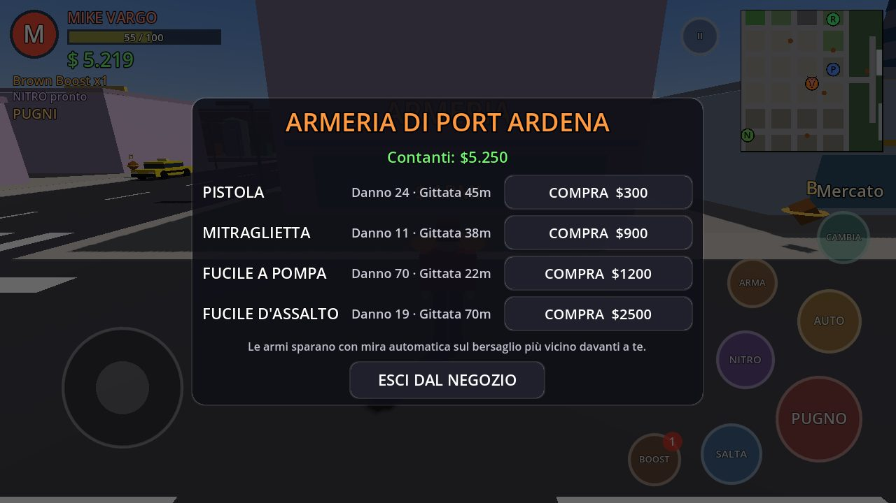 |
| 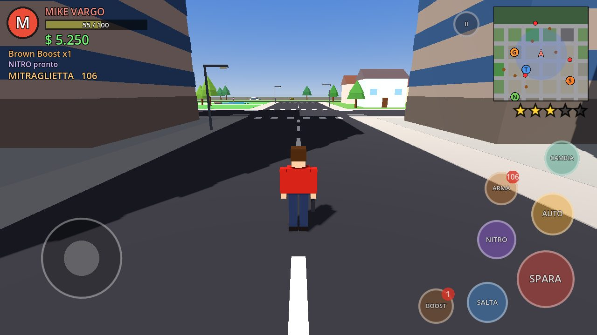 | 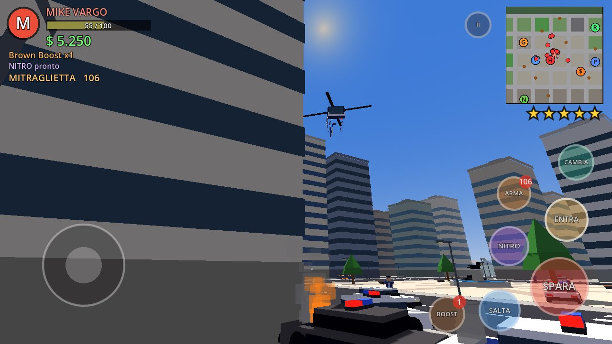 |
| 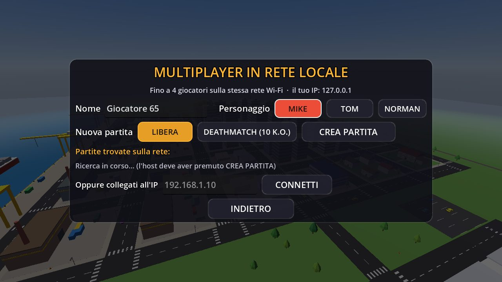 | 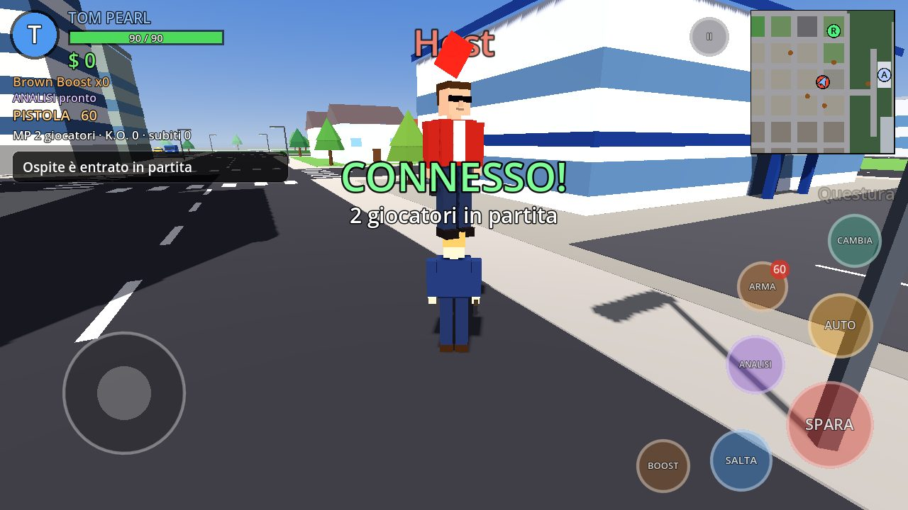 |
| 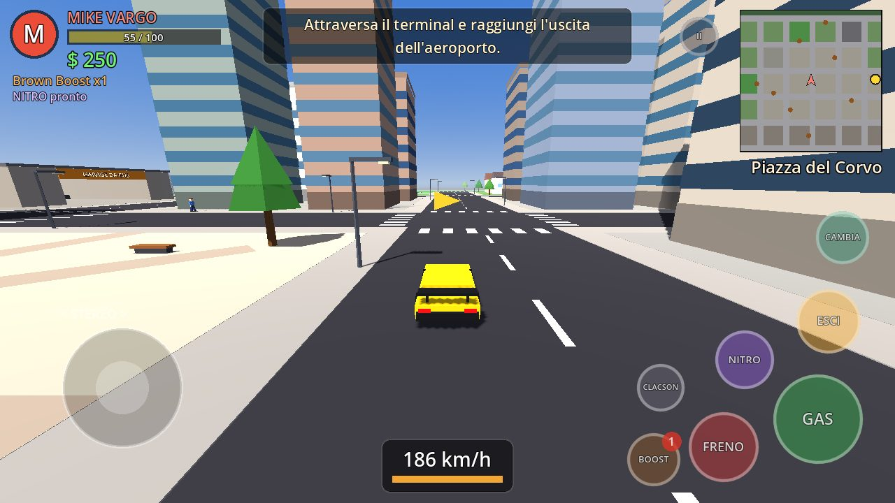 | 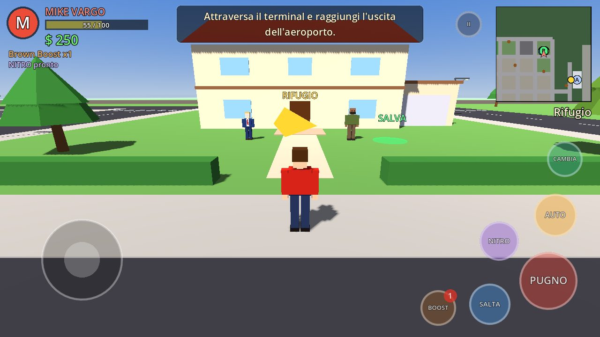 |
| 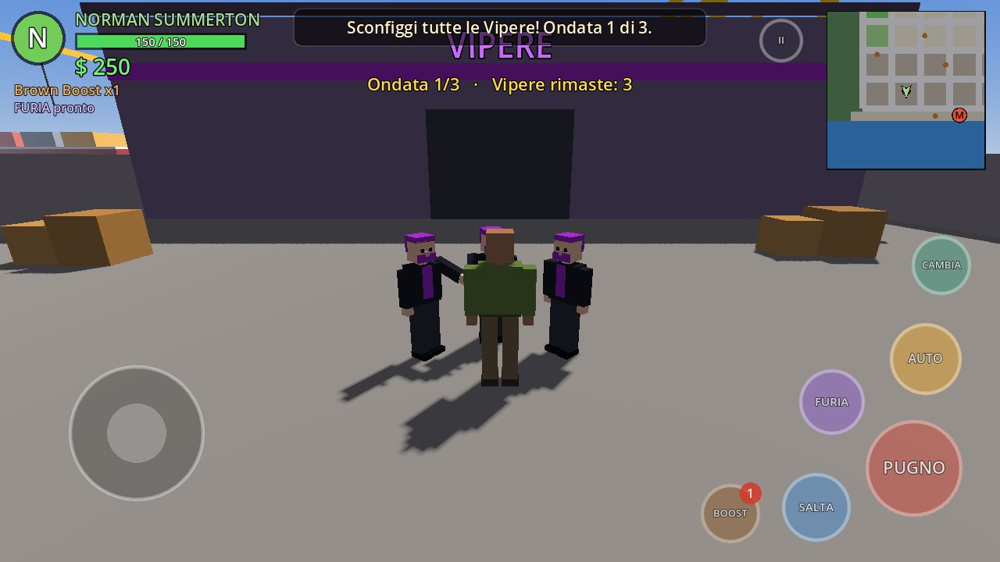 | 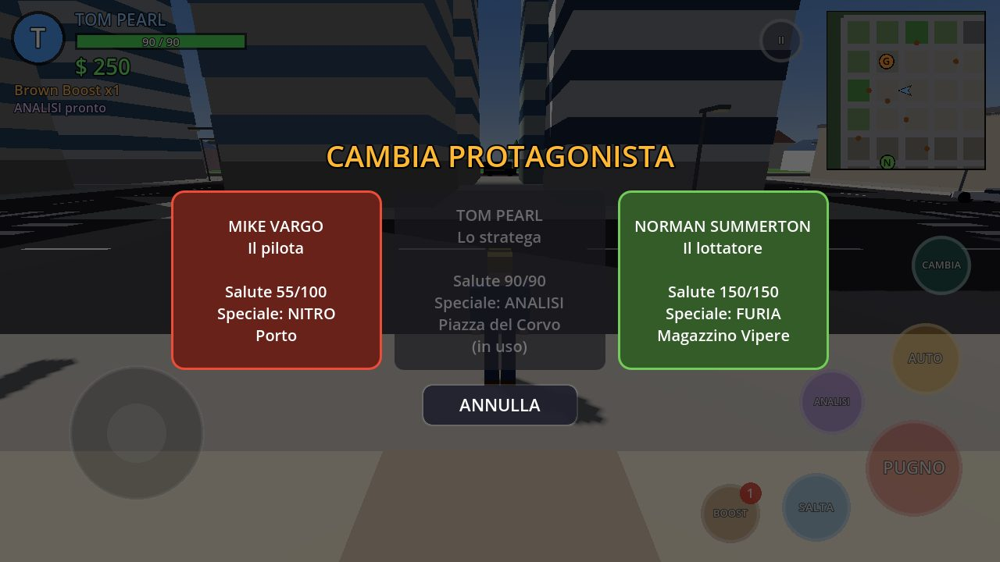 |

*Schermate catturate dal gioco reale (renderer Compatibility) con `tests/screenshot_tour.gd` e `tests/mp_test.gd`.*

---

## I protagonisti

| | Ruolo | Caratteristiche | Abilità speciale |
|---|---|---|---|
| **Mike Vargo** | Il pilota | Coraggioso; con lui le auto sono più veloci (+18%) | **NITRO**: turbo in auto, scatto a piedi |
| **Tom Pearl** | Lo stratega | Guadagna il 25% in più dalle missioni | **ANALISI**: spegne le telecamere vicine e rivela le piume nascoste |
| **Norman Summerton** | Il lottatore | 150 di salute, pugni devastanti | **FURIA**: onda d'urto, danni doppi e metà dei danni subiti |

Si passa da uno all'altro in qualsiasi momento fuori dalle missioni (pulsante **CAMBIA**, con una transizione aerea alla GTA V). Ogni protagonista resta dove lo si è lasciato.

## La storia: "La valigetta del Corvo"

Volo AR-77. Mike, Tom e Norman scortano una valigetta per conto di Silas Crane, quando un guasto al motore costringe l'aereo a un atterraggio d'emergenza a **Port Ardena**. La valigetta sparisce: al suo posto restano una piuma nera e un biglietto, *"Il Corvo vola sempre da solo"*. Per sopravvivere i tre devono scoprire chi li ha traditi.

### Missioni

1. **Arrivo in città**: dall'aeroporto al rifugio (tutorial, primo Brown Boost).
2. **Prima automobile**: trova un'auto nel parcheggio e portala nel garage di Gus.
3. **Il pacco misterioso**: recupera un pacco al porto e consegnalo a Lenny "Fumo".
4. **Fuga improvvisa**: è una trappola. Semina tre auto delle Vipere (o distruggile).
5. **Il piano di Tom** *(Tom)*: raccogli 4 indizi evitando le telecamere di sicurezza.
6. **La corsa di Mike** *(Mike)*: gara a checkpoint contro Razor entro il tempo limite.
7. **La sfida di Norman** *(Norman)*: sopravvivi a tre ondate di Vipere nel loro magazzino.
8. **La verità sulla valigetta**: *scegli tu il protagonista*. Raggiungi l'aeroporto, sperona l'auto di Dex, sconfiggi lui e le guardie e recupera la valigetta. Poi i titoli di coda e il gioco libero.

Ogni missione ha un punto di inizio sulla mappa (lettera **S**, **M**, **T**, **N** o **?**), obiettivi con faro giallo, freccia e indicatore sulla minimappa, condizioni di successo e fallimento, una ricompensa e il salvataggio automatico.

### Contenuti secondari
- **10 piume del Corvo** nascoste in città ($150 l'una, bonus $2000 per la collezione completa).
- Furto delle auto del traffico, auto sempre pronta fuori dal garage dopo la missione 2.
- Punto di salvataggio **SALVA** davanti al rifugio, che ripristina anche la salute.

## Armi

| Arma | Danno | Gittata | Cadenza | Prezzo (munizioni) |
|---|---|---|---|---|
| Pugni | dipende dal protagonista | corpo a corpo | — | — |
| **Pistola** | 24 | 45 m | media (3 colpi/s) | $300 (+24 colpi $60) |
| **Mitraglietta** | 11 | 38 m | altissima (11 colpi/s) | $900 (+60 colpi $90) |
| **Fucile a pompa** | 7 pallini × 10 | 22 m | lenta (1 colpo/s) | $1200 (+12 colpi $80) |
| **Fucile d'assalto** | 19 | 70 m | alta (8 colpi/s) | $2500 (+60 colpi $150) |

- Si comprano all'**Armeria di Port Ardena**, vicino al mercato (icona **$** sulla minimappa), e si trovano anche in 8 punti della città o cadute dagli agenti.
- **Mira automatica** sul bersaglio più vicino davanti a te (nemici, agenti, auto, elicottero, altri giocatori), con un segnalino rosso sopra la testa; tieni premuto **SPARA** per sparare di continuo.
- Il pulsante **ARMA** passa all'arma successiva e mostra le munizioni rimaste. Proiettili tracciati, fiammate, scintille e suoni sintetizzati per ogni arma.
- Armi e munizioni vengono salvate con la partita.

## Polizia e livello di ricercato (fino a 5 stelle)

I crimini aumentano il livello di ricercato: sparare, aggredire o mettere K.O. i passanti, rubare auto davanti alla polizia, distruggere veicoli, attaccare gli agenti.

| Stelle | Risposta |
|---|---|
| ★ | Una pattuglia; gli agenti cercano di **arrestarti** senza sparare |
| ★★ | Due pattuglie, agenti armati di pistola |
| ★★★ | Tre pattuglie, agenti più precisi |
| ★★★★ | Squadre **SWAT** con furgoni blindati, mitragliatrici e fucili, **elicottero** che ti segue e spara |
| ★★★★★ | Cinque unità, elicottero più aggressivo |

- Le auto della polizia hanno lampeggianti e sirena e ti inseguono; vicino a te scendono gli agenti.
- Per **seminarli** esci dall'area di ricerca (il cerchio lampeggiante sulla minimappa) e resta fuori vista per qualche secondo: le stelle lampeggiano finché nessuno ti vede.
- Al **garage di Gus** puoi far riverniciare l'auto per $100 e cancellare le stelle, ma solo dopo aver interrotto il contatto visivo.
- Se ti arrestano ("ARRESTATO!") ricompari davanti alla **Questura** con una multa di $200 e le armi sequestrate; l'eventuale missione fallisce.
- Puoi anche rubare un'auto della polizia (due sono parcheggiate davanti alla Questura).

## Multiplayer in rete locale

Fino a **4 giocatori** sulla stessa rete Wi-Fi (o hotspot), senza server esterni né account.

1. Dal menu principale scegli **MULTIPLAYER LAN**, inserisci il tuo nome e scegli Mike, Tom o Norman.
2. Un giocatore sceglie la modalità e preme **CREA PARTITA**:
   - **Libera**: girate per la città insieme, guidate e vi sfidate senza limiti;
   - **Deathmatch**: vince chi arriva per primo a **10 K.O.**; dopo 8 secondi riparte un nuovo round.
3. Gli altri trovano la partita nell'elenco *Partite trovate sulla rete* (ricerca automatica) e la toccano per entrare. Se non compare, si collegano scrivendo l'**IP dell'host** (l'host lo legge nella schermata multiplayer alla voce *il tuo IP* e nel menu di pausa) e premendo **CONNETTI**. Tutti devono avere la stessa versione del gioco.

Funzioni sincronizzate: posizione, animazioni, arma in mano e salute di ogni giocatore, colpi d'arma e pugni, K.O. e ricomparsa, punteggi (classifica con il pulsante **CAMBIA** o dalla pausa, voce **GIOCATORI**), auto guidabili da tutti (ogni auto ha un solo guidatore alla volta, assegnato dall'host). In multiplayer non ci sono missioni, traffico, passanti né polizia; le auto non si distruggono. Se l'host esce, la partita termina per tutti.

Dettagli tecnici: ENet di Godot sulla porta **UDP 7777** (l'host è anche server), annunci di scoperta in broadcast sulla porta **UDP 7778**. L'APK chiede i permessi `INTERNET`, `ACCESS_NETWORK_STATE`, `ACCESS_WIFI_STATE` e `CHANGE_WIFI_MULTICAST_STATE`. Alcune reti (Wi-Fi pubbliche o con "isolamento client") bloccano il traffico tra dispositivi: in quel caso usa un hotspot.

## Il mondo

Port Ardena è una piccola città procedurale low-poly: centro con grattacieli, Piazza del Corvo, quartieri residenziali, parchi, mercato con l'armeria, Questura, zona industriale con il magazzino delle Vipere, porto con gru e nave cargo, e un **aeroporto** con terminal, torre di controllo, hangar, pista e aerei. Ci sono traffico con IA (corsie, incroci, clacson, inseguimenti), pedoni che camminano, scappano e cadono, minimappa e mappa completa.

## Salute e Brown Boost

Ogni protagonista ha la sua barra della salute. I **Brown Boost** (oggetti marroni immaginari del gioco, con anello dorato) ripristinano 35 punti quando li raccogli; se la salute è già piena finiscono in scorta (max 5) e si usano con il pulsante **BOOST**. A salute zero arriva il **K.O.**: torni all'ultimo checkpoint (il rifugio) pagando $100 di spese mediche, le stelle si azzerano e l'eventuale missione fallisce e si può ripetere.

## Comandi

**Touch (Android, orientamento orizzontale)**
- Joystick virtuale a sinistra: muoviti; in auto sterzi.
- Trascina sulla parte destra dello schermo: ruoti la visuale.
- A piedi: **PUGNO/SPARA** (tieni premuto per il fuoco automatico), **ARMA**, **SALTA**, **ENTRA/AUTO**, abilità speciale, **BOOST**, **CAMBIA** (in multiplayer: classifica), pausa.
- In auto: **GAS**, **FRENO** (tienilo premuto per la retromarcia), **ESCI**, **NITRO/speciale**, **CLACSON**, **BOOST**.
- Tasto "indietro" di Android: pausa.

**Tastiera (per provare su PC)**: WASD/frecce per muoverti e guidare, Spazio salta, J o Ctrl pugno/spara, E o X cambia arma, F entra/esci, R speciale, B Brown Boost, Tab/Q cambia personaggio (1-2-3 diretto), H clacson, M mappa, Esc pausa.

Menu: principale (Continua, Nuova partita, Multiplayer LAN, Impostazioni, Come si gioca, Crediti), pausa (Mappa, Salva, Carica, Impostazioni, Menu principale; in multiplayer Giocatori ed Esci dalla partita), impostazioni (volumi, qualità grafica, sensibilità, opacità comandi, inversione asse, vibrazione, FPS).

## Tecnica e ottimizzazione

- **Godot 4.4.1**, solo GDScript, renderer **Compatibility** (OpenGL ES 3), adatto a molti dispositivi.
- Città, personaggi, auto, armi, elicottero e aerei sono **generati dal codice**: niente modelli, texture o audio esterni.
- La geometria statica è fusa in pochi blocchi con colori per vertice per il frustum culling; auto e personaggi hanno distanze di visibilità; i pedoni lontani vengono sospesi; nebbia di profondità legata al piano lontano della telecamera; ombre ortogonali disattivabili.
- Tre livelli di qualità (ombre, distanza visiva, densità del traffico, MSAA).
- Audio procedurale (effetti, spari, sirene, rotore, motore, musica originale sintetizzata in un thread).
- Multiplayer con le API di rete di alto livello di Godot (`ENetMultiplayerPeer` e `@rpc`): stato dei giocatori a 20 Hz con interpolazione, l'host assegna le auto e tiene i punteggi.
- Salvataggi in JSON (`user://savegame.json`) e impostazioni in `user://settings.cfg`. Nessun servizio online: la rete serve solo al multiplayer locale.
- APK per `arm64-v8a` e `armeabi-v7a`, minSdk 21, target 34.

### Struttura

```
project.godot / export_presets.cfg / icon.png
scenes/main.tscn
scripts/
  autoload/   game.gd (stato, armi, salvataggi, impostazioni), sfx.gd (audio procedurale)
  world/      world.gd, police.gd (stelle e risposta della polizia), city_builder.gd, city_data.gd,
              game_camera.gd, pickup.gd, props.gd, security_cam.gd
  actors/     actor.gd, protagonist.gd, pedestrian.gd, enemy.gd (anche agenti e SWAT), character_model.gd
  vehicles/   car.gd (fisica arcade + IA), car_model.gd, helicopter.gd
  net/        net_session.gd (host/client ENet, RPC), net_avatar.gd, lan_discovery.gd
  missions/   mission.gd, mission_manager.gd, m1 ... m8
  story/      story_text.gd (dialoghi), intro_cutscene.gd (volo iniziale)
  ui/         hud.gd, touch_controls.gd, touch_button.gd, minimap.gd, dialogue_box.gd, menus.gd, main_menu.gd, ui_kit.gd
  util/       mesh_batch.gd, chunked_batch.gd, gfx.gd
tests/        test_runner.gd (134 controlli end-to-end), mp_test.gd (multiplayer con due processi), screenshot_tour.gd
tools/        make_icon.py
.github/workflows/android-release.yml
```

## Test automatici

Il gioco include una suite che gira dentro il motore vero (scene, fisica, IA) e verifica: mondo, traffico e pedoni; cambio dei tre protagonisti e abilità; Brown Boost (raccolta, scorta, uso); comandi touch (pulsanti, joystick, visuale); guida (entrata, accelerazione, sterzo, frenata, uscita, furto); collisioni con edifici e tra veicoli; tutte le 8 missioni dall'inizio alla fine; K.O. e ritorno al checkpoint; salvataggio e caricamento; impostazioni; **armi** (mira automatica, danni di pistola e fucile a pompa, munizioni, cambio arma, raccolta da terra, acquisto all'armeria, danni alle auto); **polizia** (1, 3 e 5 stelle, pattuglie, agenti a piedi armati, elicottero abbattibile, seminare, arresto con multa e sequestro, riverniciatura, K.O.).

Il test del **multiplayer** avvia due istanze reali del gioco che si collegano via ENet: il client trova la partita con la ricerca automatica, si muove, mette K.O. l'host con la pistola, guida un'auto sincronizzata e la rilascia; l'host verifica tutto dal suo lato.

```bash
godot --headless --path . --import
godot --headless --fixed-fps 60 --path . -- --run-tests

# multiplayer: due processi sulla stessa macchina
godot --headless --path . -- --mp-test=host --mp-port=7790 &
godot --headless --path . -- --mp-test=client --mp-port=7790
```

## Compilare l'APK in locale

1. Installa Godot 4.4.1 e i relativi **export template**.
2. In *Editor → Impostazioni editor → Export → Android* imposta il percorso dell'Android SDK (platform-tools + build-tools) e di un JDK 17.
3. Esporta il preset **Android** (`Progetto → Esporta`), oppure da riga di comando:

```bash
export GODOT_ANDROID_KEYSTORE_RELEASE_PATH=/percorso/release.keystore
export GODOT_ANDROID_KEYSTORE_RELEASE_USER=alias
export GODOT_ANDROID_KEYSTORE_RELEASE_PASSWORD=password
godot --headless --path . --export-release "Android" build/GTA_Three_Legends.apk
```

## Build e pubblicazione automatica (GitHub Actions)

Il workflow `.github/workflows/android-release.yml`:
1. scarica il progetto, Godot 4.4.1 e i template Android (con cache);
2. configura JDK 17 e Android SDK;
3. importa il progetto ed esegue i **test automatici** e il **test multiplayer** con due processi (la build si ferma se un test fallisce);
4. esporta l'**APK di release firmato**;
5. verifica che l'APK esista, non sia vuoto, sia firmato correttamente e contenga le librerie;
6. lo pubblica come asset della **GitHub Release `v<versione>`** (versione letta da `project.godot`, oggi `v1.1.0`);
7. controlla che l'asset sia davvero presente e scaricabile e scrive nel riepilogo il link alla release e il link diretto all'APK.

Su ogni push e pull request vengono eseguiti build, test e verifica, e l'APK è disponibile come artifact. La release si aggiorna sui push al branch predefinito, sui tag `v*` o con l'avvio manuale (*Run workflow*).

### Firma dell'APK

Per una firma di release stabile, aggiungi questi **secrets** al repository (*Settings → Secrets and variables → Actions*):

| Secret | Contenuto |
|---|---|
| `ANDROID_KEYSTORE_BASE64` | il keystore codificato: `base64 -w0 release.keystore` |
| `ANDROID_KEYSTORE_ALIAS` | alias della chiave |
| `ANDROID_KEYSTORE_PASSWORD` | password del keystore e della chiave |

Per creare un keystore: `keytool -genkeypair -v -keystore release.keystore -alias threelegends -keyalg RSA -keysize 2048 -validity 10000`.

Se i secrets mancano, la pipeline **non si blocca**: firma l'APK con una chiave di test generata al momento (l'APK è installabile) e lo segnala con un avviso nel log e nelle note della release. Nessuna password o chiave è salvata nel codice sorgente.

> Con la chiave di test ogni build ha una firma diversa: per aggiornare un'installazione precedente Android chiede di disinstallare prima la vecchia versione. Con i secrets configurati gli aggiornamenti si installano sopra.

## Note legali

Personaggi, storia, dialoghi, grafica e audio sono originali e generati dal codice del progetto. Godot Engine è distribuito con licenza MIT. "GTA" è un marchio di Take-Two Interactive / Rockstar Games: questo è un progetto amatoriale non affiliato. Prima di distribuirlo pubblicamente (es. sul Play Store) è consigliabile usare un titolo diverso. I *Brown Boost* sono oggetti immaginari del gioco.
